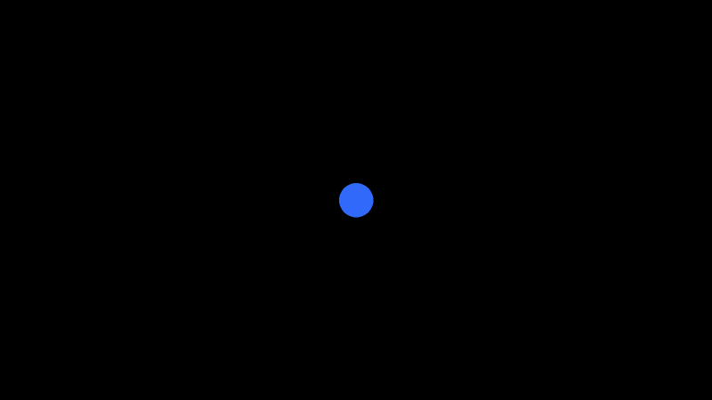

<!-- 프로젝트 루트의 docs/{daily|weekly|monthly}/YYYY/MM/DD/에 마크다운과 HTML을 저장한다. HTML은 header 없이 같은 주기의 예시와 같은 main 구조를 쓴다. -->
GitHub Trending · {{Daily | Weekly | Monthly 중 이번 호 하나}}

{{YYYY.MM.DD}} · {{AM/PM hh:mm}} 기준 (KST)

<!-- 시각은 실제 조회 시각을 쓴다. 표시 예: AM 08:00 기준. 시안에서는 회색 보조 글자로 표시한다. Daily는 daily, Weekly는 weekly, Monthly는 monthly 목록을 조회하며 제목·순위·출처에 같은 기간을 쓴다. -->
# {{MM.DD}} GitHub {{일간·주간·월간}} 트렌딩 {{목록 전체 개수}}개 · 대표 소개｜{{저장소 자체의 핵심 기능이나 도구 유형}} {{대표 도구 이름}}

<!-- 기본 GIF를 표지로 선택했으면 글 제목 바로 아래에 캡션 없이 GIF만 한 번 표시한다. 플랫폼이 이 자리에 기본 표지를 자동으로 표시하면 그 표시로 갈음한다. 원고와 미리보기에서 열리는 경로로 파일을 함께 배포한다.

-->

<!-- 대표 저장소는 조회된 목록 안에서 고른다. 독자가 떠올릴 만한 상황과, 그때 얻는 결과를 공식 예제로 설명할 수 있는지 본다. 대표 소개에도 GitHub가 매긴 원래 순위를 표시한다. -->

## 대표 저장소 자세히 보기 · {{대표 도구 이름}}

[ {{owner/repo}}]({{저장소 URL}})

**{{일간·주간·월간 중 하나}} {{순위}}위** · {{오늘·이번 주·이번 달 중 하나}} ★ +{{기간 스타}} · 누적 ★ {{누적 스타}}

<!-- 같은 시각에 읽은 Trending 목록에서 표시 순서(첫 행이 1위), 기간 스타, 누적 스타를 함께 기록하고 대표 소개와 전체 목록에 같은 값을 쓴다. 스타 수로 재정렬하지 않는다. 숫자는 세 자리마다 쉼표를 찍는다. 누락된 지표는 ‘미표시’로 적는다. -->

<!-- 편집 기준: 처음 듣는 독자가 예시 하나만으로 이해할 수 있게 쓴다. '채널별 소재 제작에 활용해요'처럼 다른 도구에도 붙일 수 있는 문장은 구체적인 물건·행동·결과로 바꾼다. 낯선 용어는 필요한 자리에서 풀어 쓴다. 직접 해봤다는 표현은 실행 기록이 있을 때만 쓴다. -->
{{첫 문단에서 이 저장소가 무엇이고 어떤 일을 돕는지 쉬운 말로 밝힌다. 다음 문단의 사례가 바뀌어도 이 소개가 성립하는지 확인한다.}}

{{공식 예시나 직접 실행한 사례를 바탕으로, 이 도구의 주된 쓰임이 드러나는 일을 골라 무엇을 맡기는지 보여 준다. 첫 문단에서 이어 쓰되, 사례만으로 쓰임새가 드러나면 거기서 마친다. 예시의 출처는 이 문단이나 바로 아래 캡션에 둔다. 수치나 성능을 언급할 때는 해당 결과가 나온 조건과 출처를 함께 적는다.}}

<!-- 피드 표지에는 대표 소개에서 고른 공식 이미지나 GIF를 쓴다. 적합한 공식 자료가 없으면 연재 기본 표지(github-trending-cover-v4.gif)를 쓴다. 선택한 파일 또는 공식 URL을 원고와 함께 전달한다. -->

<!-- 공식 예시를 고르는 순서
1. 이번 글에서 독자가 확인할 장면을 한 문장으로 정한다. 예: 회의 메모 옆에 흐름도를 놓는 모습.
2. 공식 README·문서·examples를 렌더링한 화면에서 본문 관련 후보를 찾는다. 마크다운 이미지, HTML img·picture·video, 링크로 연결된 데모, 확장자가 없는 GitHub 첨부 파일도 확인한다.
3. 후보를 직접 열어 같은 질문으로 비교한다. 글에서 약속한 작업이나 결과가 실제로 보이는가? 모바일 크기에서도 어디를 봐야 할지 알 수 있는가? 움직이는 자료는 재생해서 해당 장면까지 확인한다. 파일명·확장자·등장 순서·주변 설명만으로 고르지 않는다.
4. 확인한 후보 중 쓰임새가 가장 잘 보이는 자료를 고르고, 캡션에는 실제로 보이는 장면을 적는다. 열리지 않거나 재생을 확인할 수 없는 자료는 건너뛴다. 적합한 공식 자료가 있으면 직접 실행은 생략한다.

*{{눈여겨볼 결과}} · [공식 예제]({{이미지가 실린 저장소 페이지 URL}})*

적합한 공식 이미지가 없고 화면이 설명에 도움이 될 때만 임시 Linux 컨테이너에서 공식 예제를 실행한다. 웹 UI는 결과 화면을 캡처하고 차트·이미지는 생성 파일을 사용한다.

*직접 실행 · {{태그 또는 짧은 커밋}} · {{입력 예시와 눈여겨볼 결과}}*

활용 예시 바로 뒤에 선택한 공식 이미지·GIF 또는 직접 실행한 화면과 캡션 한 쌍을 출력한다. 화면 자료가 없으면 글로 설명한다. 짧은 명령 실행 결과는 텍스트로 적는다.
-->

<!-- 독자가 같은 예시를 직접 해볼 수 있는 공식 데모나 빠른 시작 자료가 있으면 링크를 덧붙여도 좋다. 필요한 계정이나 샘플 파일이 있으면 링크 옆에 적는다. -->

<!-- Docker에서 예제를 직접 실행해 결과를 확인한 날에만 아래 접이식 기록을 공개한다. 작성 에이전트는 실행 시점의 기록에서 원문과 명령을 가져온다. 공식 자료만 소개한 날에는 이 블록을 생략한다. 공개용 샘플과 상대경로를 사용하고 키·개인정보는 제외한다. 가린 부분은 [가림]으로 표시한다. -->
<details>
<summary>직접 실행한 프롬프트와 명령 보기</summary>

**에이전트에게 준 작업 요청**

```text
{{이 예제를 실행하도록 에이전트에 실제 전달한 작업 요청 원문}}
```

**실행 환경** · {{저장소 태그 또는 커밋}} · {{컨테이너 이미지와 태그 또는 다이제스트}}

**입력** · {{공개 샘플 경로 또는 링크}} {{도구 자체가 프롬프트를 받았다면 실제 입력 문구도 첨부}}

```sh
{{같은 샘플로 결과를 재현하는 데 사용한 Docker 실행 및 예제 명령}}
```

**관찰한 결과** · {{결과 파일 또는 출력과 직접 확인한 점}}

</details>

## GitHub 트렌딩 저장소 {{일간 | 주간 | 월간}} 순위 · {{실제 순위 범위}}

<!-- 조회 시점의 고정 URL을 제공받으면 ‘조회 당시 순위’ 링크를 함께 표시한다. 별도 순위 파일은 생성하지 않는다. -->
[현재 GitHub 순위](https://github.com/trending?since={{daily 또는 weekly 또는 monthly}})

<!-- 첫 순위부터 마지막 순위까지 아래 블록을 반복한다. 대표 저장소도 원래 순위에 포함하고 한 줄 요약만 남긴다. 그 외 저장소는 각각 공식 자료를 확인해 구체적인 사용 예시를 한 가지씩 쓴다. 자료 모음이라면 실제 수록 자료를 예로 든다. -->

### {{순위}}위 · [ {{owner/repo}}]({{공식 README URL}}) · {{핵심 기능이나 도구 유형을 짧게}}

{{오늘·이번 주·이번 달}} ★ +{{기간 스타}} · 누적 ★ {{누적 스타}}

{{무엇을 넣거나 선택하면 어떤 결과를 얻는지 쉬운 말로 한 문장.}}

**이럴 때** · {{이 결과가 필요한 상황을 한 문장으로 쓴다. 예: 지난 회의에서 정한 마감일이 슬라이드 어디에 있는지 기억나지 않을 때, 변환한 텍스트에서 ‘마감’을 검색한다.}}

<!-- 전체 순위에서는 각 3단계 제목(h3)의 16×16 GitHub 아이콘과 저장소 이름을 하나의 공식 README 링크로 묶는다. 문장 끝에는 데모나 예제처럼 제목 링크와 목적지가 다른 자료만 덧붙인다. 전문 도구도 실제 작업 이름으로 설명한다. 예: 배포가 실패했을 때 어느 단계에서 멈췄는지 찾는다. -->
